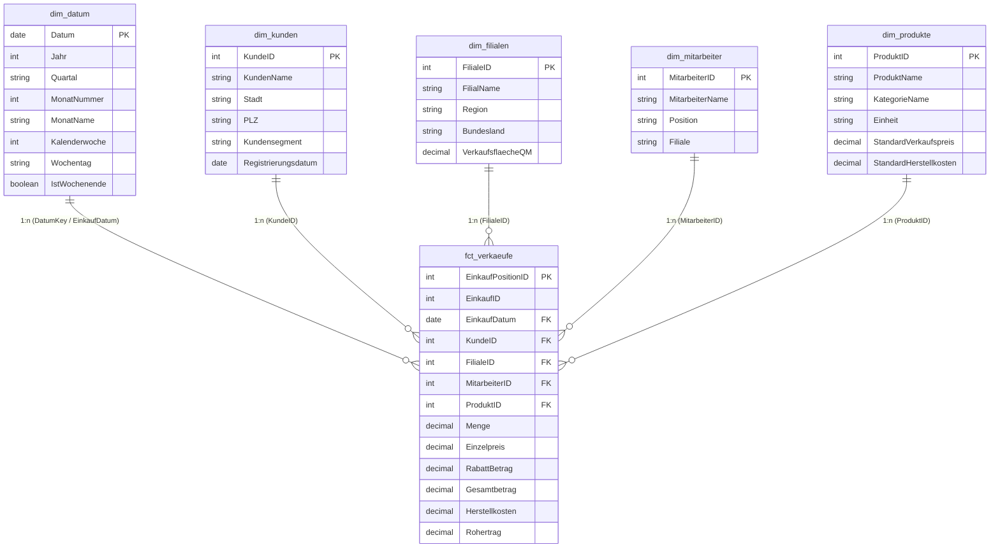

# 🏗 Sternschema-Datenmodell (Star Schema Architecture)
### Enterprise Power BI Datenmodellierung nach Ralph Kimball

Dieses Dokument spezifiziert das dimensionale Datenmodell für das **Supermarkt Retail Analytics Dashboard**. Es ist optimiert für maximale DAX-Performance, saubere Filterweitergabe (Filter Propagation) und schnelle Reaktionszeiten in Power BI.

---

## 1. Beziehungsdiagramm (Entity-Relationship-Übersicht)

---

## 2. Modellierungs-Regeln (Best Practices für PL-300 / DA-100)

1. **Reine Stern-Architektur (Kein Schneeflockenschema):**
   * Die Tabelle `Kategorien` wurde direkt in `dim_produkte` denormalisiert. Dadurch entfällt ein unnötiger JOIN im Power BI VertiPaq-Engine-Speicher.
2. **Kardinalität & Filterrichtung:**
   * Alle Beziehungen sind strikt **1:n (Eins-zu-Viele)**.
   * Die Kreuzfilterrichtung ist auf **Einfach (Single)** eingestellt.
   * Filter fließen immer von den Dimensionstabellen zur Faktentabelle `fct_verkaeufe`, niemals umgekehrt.
3. **Ausblenden technischer Fremdschlüssel:**
   * In Power BI werden alle technischen Schlüsselspalten (`ProduktID`, `KundeID`, `FilialeID`) in der Faktentabelle in der Berichtsansicht ausgeblendet (*Hide in report view*).
   * Visualisierungen und Slicer nutzen ausschließlich die Beschriftungen der Dimensionstabellen.
