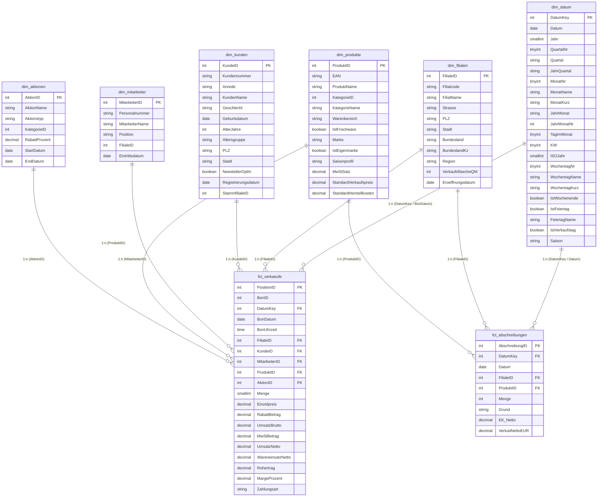

# 🏗 Sternschema-Datenmodell
### Power-BI-Datenmodellierung nach Ralph Kimball
### Datengrundlage: FrischMarkt GmbH (`SupermarktDWH`)

Dieses Dokument spezifiziert das dimensionale Datenmodell für das **Supermarkt Retail Analytics Dashboard**. Es ist optimiert für maximale DAX-Performance, saubere Filterweitergabe und schnelle Reaktionszeiten im VertiPaq In-Memory-Speicher von Power BI Desktop und Microsoft Fabric Direct Lake.

---

## 1. Beziehungsdiagramm (Entity-Relationship-Übersicht)

---

## 2. Modellierungsregeln (bewährte Praxis, Prüfungsstoff PL-300)

1. **Reines Sternschema (kein Snowflake-Schema):**
   * Die Tabelle `Kategorien` wurde direkt in `dim_produkte` denormalisiert (`KategorieName`, `Warenbereich`, `IstFrischware`). Dadurch entfällt ein unnötiger JOIN im VertiPaq-Engine-Speicher.
2. **Kardinalität & Filterrichtung:**
   * Alle Beziehungen zwischen Dimensionen und Faktentabellen sind streng **1:n (Eins-zu-Viele)**.
   * Die Kreuzfilterrichtung ist ausnahmslos auf **Einfach (Single)** gesetzt. Die Dimensionen filtern die Fakten, niemals umgekehrt.
3. **Surrogatschlüssel:**
   * Als Datumsschlüssel wird `DatumKey` (Format `JJJJMMTT`, z. B. `20260415`) als Integer verwendet. Dies minimiert den Speicherbedarf im VertiPaq-Columnstore.
4. **Trennung von Fakten und Aggregationen:**
   * Alle quantitativen Basisfelder (`UmsatzBrutto`, `Rohertrag`, `Menge`) verbleiben in der Faktentabelle.
   * Sämtliche weiterführenden Kennzahlen (Margen %, Vorjahresvergleiche, ABC-Ränge) werden dynamisch über **explizite DAX-Measures** berechnet, nicht über berechnete Spalten.
