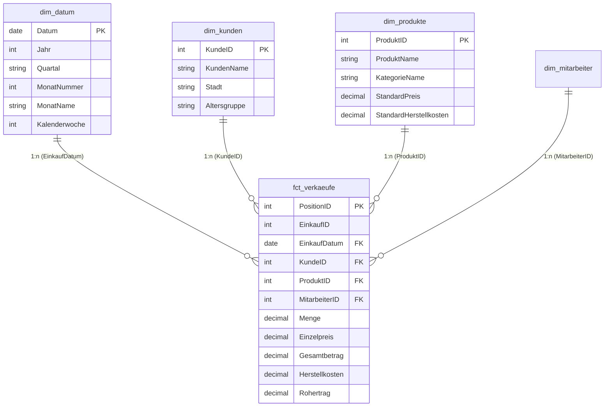

# 📊 Supermarkt Retail Analytics & Power BI Enterprise Solution
### End-to-End Business Intelligence Projekt (Sternschema, Power Query M, DAX & Report Design)

[](https://powerbi.microsoft.com/)
[](https://learn.microsoft.com/dax/)
[](https://learn.microsoft.com/power-query/)
[](https://www.microsoft.com/sql-server)
[](#)

---

## 📌 Projektübersicht & Unternehmenskontext

Dieses Repository enthält die **vollständige, produktionsreife Vorlage für ein Enterprise Power BI Dashboard** im Lebensmitteleinzelhandel (Supermarkt). 

Es deckt den gesamten Workflow eines modernen **BI Analysts / Power BI Developers** ab:
1. **Datenbank-Views & Sternschema-Modellierung** (Fakten- und Dimensionstabellen nach Kimball).
2. **Power Query (M) Skripte** für die ETL-Pipeline und eine dynamische ISO-Datumstabelle.
3. **Umfassende DAX-Kennzahlenbibliothek** (Time Intelligence, YoY/MoM, ABC-Pareto, Warenkorb-KPIs).
4. **Vollständige UI/UX-Dashboard-Spezifikation** für ein professionelles 4-Seiten Management-Reporting.

---

## 🏗️ Sternschema-Datenmodell (Star Schema)

Das Datenmodell ist strikt als reines **Sternschema (Star Schema)** mit 1:n-Beziehungen und einfacher Filterrichtung konzipiert:



---

## 📂 Struktur des Repositories

```text
PowerBI-Supermarkt-Analytics/
├── README.md                                          # Projektübersicht & Schnellstart
│
├── 01_Data_Model_Architecture/
│   ├── 01_star_schema_design.md                       # Modellierungsregeln & Kardinalitäten
│   └── 02_create_views_sql.sql                        # SQL-Views für SupermarktV2 (SQL Server)
│
├── 02_Power_Query_M_Scripts/
│   ├── fx_DateTable_German.m                          # Dynamische M-Kalenderfunktion (DIN/ISO)
│   └── transform_supermarkt_data.m                    # M-Abfragen für Tabellenübernahme
│
├── 03_DAX_Measures_Library/
│   ├── 01_base_measures.dax                           # Umsatz, Rohertrag, Marge %, Bonwert (AOV)
│   ├── 02_time_intelligence.dax                      # YoY, MoM, YTD, SPLY, Rolling 3M Avg
│   ├── 03_customer_and_basket_kpis.dax                # Aktive Kunden, Artikel pro Bon, Wiederkaufrate
│   ├── 04_advanced_abc_ranking.dax                    # Dynamisches Pareto-Ranking & ABC-Klassen
│   └── 05_formatting_and_dynamic_titles.dax           # Dynamische Titel, Trendpfeile ▲/▼, Hex-Farben
│
└── 04_Report_Design_and_Mockups/
    ├── dashboard_layout_specification.md              # 4-Seiten Dashboard Grid & Visual-Anordnung
    └── corporate_theme.json                           # Importierbares Farb- & Schrift-Theme
```

---

## ⚡ Schnellstart: In 5 Minuten in Power BI Desktop nachbauen

1. **SQL-Views anlegen:** Führen Sie das Skript `01_Data_Model_Architecture/02_create_views_sql.sql` in Ihrer SQL Server Instanz (`SupermarktV2`) aus.
2. **Daten importieren:** Öffnen Sie Power BI Desktop ➔ *Daten abrufen* ➔ *SQL Server* ➔ Server: `localhost\SQLEXPRESS`, Datenbank: `SupermarktV2` ➔ Wählen Sie die 4 Views `vw_fct_verkaeufe`, `vw_dim_produkte`, `vw_dim_kunden`, `vw_dim_mitarbeiter`.
3. **Datumstabelle einfügen:** Öffnen Sie den Power Query Editor ➔ Neue Abfrage ➔ M-Code aus `02_Power_Query_M_Scripts/fx_DateTable_German.m` einfügen ➔ Schließen & Übernehmen. Als Datumstabelle markieren.
4. **Beziehungen prüfen:** Wechseln Sie in die Modellansicht und stellen Sie sicher, dass 1:n Beziehungen von den Dimensionen zur Faktentabelle `vw_fct_verkaeufe` bestehen.
5. **DAX-Measures importieren:** Erstellen Sie eine dedizierte Measures-Tabelle `_Measures` und fügen Sie die Kennzahlen aus `03_DAX_Measures_Library/` ein.

---

## 💼 Bewerbung & Interview-Leitfaden (DACH-Markt)

Dieses Projekt demonstriert im Vorstellungsgespräch:
* **Verständnis für Datenarchitektur:** Klare Trennung von ETL (SQL/M) und semantischer Modellierung (DAX).
* **Betriebswirtschaftliche Kennzahlenkompetenz:** Deckungsbeitrag, Rohertragsmarge, Time Intelligence und Wiederkaufraten.
* **Saubere Best Practices:** Explizite Measures statt impliziter Felder, Vermeidung bidirektionaler Filter, einheitliche Farbthemen.
