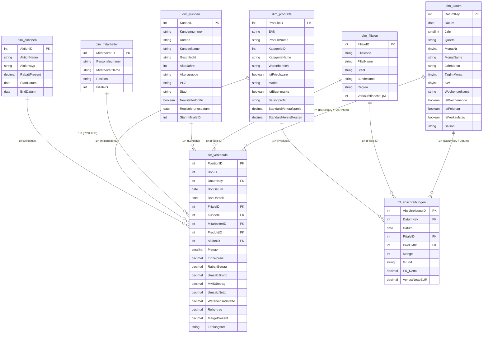

# 📊 FrischMarkt Retail Analytics & Power BI Enterprise Solution
### End-to-End Business Intelligence Projekt (Sternschema, Power Query M, DAX & Report Design)
### Datengrundlage: FrischMarkt GmbH (`SupermarktDWH`) · 5 Filialen · 120 Artikel · ~755.000 Positionen

[](https://powerbi.microsoft.com/)
[](https://learn.microsoft.com/dax/)
[](https://learn.microsoft.com/power-query/)
[](https://www.microsoft.com/sql-server)
[](#)

---

## 📌 Projektübersicht & Unternehmenskontext

Dieses Repository dokumentiert eine **vollständige, produktionsreife Business Intelligence Lösung** für das fiktive Filialunternehmen **„FrischMarkt GmbH“** (Lebensmitteleinzelhandel mit 5 Standorten in Niedersachsen und Nordrhein-Westfalen).

Das Projekt demonstriert den durchgängigen Workflow eines modernen **BI Analysts / Power BI Developers**:
1. **DWH-Architektur & SQL Server Views:** Sauberes Sternschema nach Kimball-Methodologie, performante Indizierung und Entkopplung von ETL und Reporting.
2. **Power Query (M) Skripte:** Robuste Datenaufnahme und eine dynamische ISO-8601-Datumstabelle mit deutscher Feiertagslogik.
3. **DAX-Kennzahlenbibliothek:** 60+ explizite Measures (Time Intelligence YoY/MoM/YTD, Filterkontext-Manipulation via `CALCULATE`/`ALL`/`KEEPFILTERS`, dynamisches ABC-Pareto-Ranking, Kundenkarten-Penetration).
4. **Visuelles Design:** Vollständige 4-Seiten Dashboard-Spezifikation nach IBCS-Standards mit standardisiertem JSON-Corporate-Theme.

---

## 🖥️ Dashboard-Vorschau & Semantisches Datenmodell

Hier sind die zentralen visuellen Berichtsseiten des **FrischMarkt Executive Dashboards** in Power BI Desktop:

```
┌────────────────────────────────────────────────────────────────────────────────────────┐
│ Seite 1: Executive KPI Summary (Umsatz, Rohertrag, Vorjahresvergleich YoY & Trends)   │
├────────────────────────────────────────────────────────────────────────────────────────┤
│ Seite 2: Category & Sortiment (Pareto ABC-Klassifizierung nach Umsatz & Marge)        │
├────────────────────────────────────────────────────────────────────────────────────────┤
│ Seite 3: Filial-Benchmarking (Flächenproduktivität, Umsatz je m² & Standortvergleich)  │
├────────────────────────────────────────────────────────────────────────────────────────┤
│ Seite 4: Kundenkarten- & Warenkorbanalyse (Loyalität, UPT & Bonwert-Verteilung)        │
└────────────────────────────────────────────────────────────────────────────────────────┘
```

> 📷 **Dashboard Screenshots:**
> Die Berichtsseiten wurden nach den Vorgaben der Spezifikation ([`dashboard_layout_specification.md`](04_Report_Design_and_Mockups/dashboard_layout_specification.md)) und dem Farbschema ([`corporate_theme.json`](04_Report_Design_and_Mockups/corporate_theme.json)) gestaltet.

---

## 💡 Zentrale Business Insights & Handlungsempfehlungen

Die Analyse des Datenbestands (01/2024 – 09/2026, 2,51 Mio. € Bruttoumsatz, 768.980 € Rohertrag) deckt entscheidende Steuerungspotenziale für die Geschäftsführung auf:

```
┌────────────────────────┬──────────────────┬─────────────────┬──────────────┬───────────────┐
│ Warengruppe            │ Bruttoumsatz     │ Rohertrag (€)   │ Marge (%)    │ Positionen    │
├────────────────────────┼──────────────────┼─────────────────┼──────────────┼───────────────┤
│ Fleisch & Wurst        │ 475.013,91 €     │ 137.751,32 €    │ 30,9 %       │ 96.246        │
│ Getränke               │ 447.786,33 €     │ 119.123,92 €    │ 34,0 %       │ 100.468       │
│ Trockensortiment       │ 347.388,46 €     │ 90.245,87 €     │ 30,1 %       │ 94.830        │
│ Drogerie & Haushalt    │ 289.302,41 €     │ 96.742,42 €     │ 40,4 %       │ 60.778        │
│ Obst & Gemüse          │ 283.174,90 €     │ 106.987,21 €    │ 40,7 %       │ 114.589       │
│ Molkereiprodukte       │ 262.689,18 €     │ 58.038,36 €     │ 24,4 %       │ 114.898       │
│ Süßwaren & Snacks      │ 215.311,58 €     │ 68.448,85 €     │ 34,2 %       │ 78.251        │
│ Backwaren              │ 193.205,11 €     │ 91.645,88 €     │ 51,7 %       │ 94.630        │
└────────────────────────┴──────────────────┴─────────────────┴──────────────┴───────────────┘
```

### 1. Margendruck bei Molkereiprodukten (Handlungsbedarf Category Management)
* **Befund:** Obwohl Molkereiprodukte mit 114.898 Bonpositionen zu den am häufigsten gekauften Artikeln zählen, liegt die durchschnittliche Marge bei nur **24,4 %** (deutlich unter dem Supermarkt-Schnitt von 32,8 %). Im Jahr 2026 stiegen die Netto-Einkaufspreise um bis zu 9 %, während die Regalpreise nur um 2,5 % angepasst wurden.
* **Empfehlung:** Gezielte Förderung margenstärkerer Eigenmarken-Alternativen im Regal und sukzessive Preisanpassung bei Nischenartikeln.

### 2. Abschreibungen & Verderb (MHD-Verluste bei Frischeware)
* **Befund:** In der Verlustanalyse entfallen **36.658,63 € (70,0 % aller Abschreibungen)** auf abgelaufene Mindesthaltbarkeitsdaten (MHD) bei Obst & Gemüse sowie Frischeartikeln. Bruch und Beschädigung machen dagegen nur 10.537,67 € aus.
* **Empfehlung:** Einführung eines dynamischen Abverkaufsrabatts (-30 % Aufkleber) 48 Stunden vor Ablauf des MHD sowie Optimierung der Filial-Bestellzyklen.

### 3. Wettbewerbsdruck am Standort Braunschweig
* **Befund:** Während die Standorte Hannover-Mitte und Bielefeld stabile Zuwächse verzeichnen, sank der Umsatz der Filiale Braunschweig ab Juni 2025 um rund **16 %** (Wettbewerber-Eröffnung im unmittelbaren Einzugsgebiet).
* **Empfehlung:** Lokale Marketingoffensive über die Kundenkarte und exklusive Aktionen am Wochenende zur Stabilisierung der Kundenfrequenz.

---

## 🏗️ Sternschema-Datenmodell (Star Schema)

Das Modell ist strikt als **Kimball-Sternschema** ohne zirkuläre Abhängigkeiten und mit einfacher 1:n Filterweitergabe implementiert:



---

## 📂 Struktur des Repositories

```text
PowerBI-Supermarkt-Analytics/
├── README.md                                          # Projektübersicht, Insights & Architektur
├── 00_anleitung_die_3_ebenen_in_power_bi.md           # Architektur-Leitfaden: Das 3-Ebenen-Prinzip
│
├── 01_Data_Model_Architecture/
│   ├── 01_star_schema_design.md                       # Modellierungsregeln & Kardinalitäten
│   └── 02_create_views_sql.sql                        # SQL-Views für SupermarktDWH (SQL Server 2022)
│
├── 02_Power_Query_M_Scripts/
│   ├── fx_DateTable_German.m                          # Dynamische M-Kalenderfunktion (DIN/ISO)
│   └── transform_supermarkt_data.m                    # M-Abfragen für Tabellenübernahme
│
├── 03_DAX_Measures_Library/
│   ├── 01_base_measures.dax                           # Umsatz, Rohertrag, Marge %, Bonwert (AOV)
│   ├── 02_time_intelligence.dax                      # YoY, MoM, YTD, SPLY, Rolling 3M & 12M MAT
│   ├── 03_customer_and_basket_kpis.dax                # Aktive Kunden, Wiederkaufrate, Basket Size
│   ├── 04_advanced_abc_ranking.dax                    # Dynamisches Pareto-Ranking & ABC-Klassen
│   └── 05_formatting_and_dynamic_titles.dax           # Filterkontext-Manipulation (ALL, KEEPFILTERS), IBCS
│
└── 04_Report_Design_and_Mockups/
    ├── dashboard_layout_specification.md              # 4-Seiten Dashboard Grid & Visual-Anordnung
    └── corporate_theme.json                           # Importierbares Farb- & Schrift-Theme (JSON)
```

---

## ⚡ Schnellstart: In 5 Minuten in Power BI Desktop nachbauen

1. **Datenbank anlegen:** Skript `00_SETUP/01_SupermarktDWH_erstellen.sql` aus dem Nachbar-Repository `sql-analyst-toolkit` in SQL Server 2022 ausführen.
2. **Views einrichten:** Skript `01_Data_Model_Architecture/02_create_views_sql.sql` ausführen.
3. **Daten importieren:** Power BI Desktop ➔ *Daten abrufen* ➔ *SQL Server* (`localhost\SQLEXPRESS`, Datenbank: `SupermarktDWH`) ➔ Views im Schema `dwh` auswählen (`vw_fct_verkaeufe`, `vw_fct_abschreibungen`, `vw_dim_produkte`, `vw_dim_kunden`, `vw_dim_filialen`, `vw_dim_mitarbeiter`, `vw_dim_aktionen`, `dim_datum`).
4. **Beziehungen prüfen:** In der Modellansicht sicherstellen, dass 1:n Beziehungen von den Dimensionen zu den beiden Faktentabellen mit einfacher Filterrichtung aktiv sind.
5. **DAX-Bibliothek einbinden:** Dedizierte Kennzahlentabelle `_Measures` anlegen und die Kennzahlen aus `03_DAX_Measures_Library/` einfügen.
6. **Theme laden:** Menü *Ansicht* ➔ *Designs* ➔ *Nach Designs suchen* ➔ `corporate_theme.json` auswählen.

---

## 🔗 Offizielle Dokumentation & Referenzen

* 📖 **Offizielle Microsoft DAX-Sprachreferenz (Deutsch):**  
  👉 [https://learn.microsoft.com/de-de/dax/](https://learn.microsoft.com/de-de/dax/)
* 🧭 **DAX.guide (Die weltweite Standard-Referenz von SQLBI):**  
  👉 [https://dax.guide/](https://dax.guide/)
* ⚡ **Microsoft Power Query M Sprachreferenz (Deutsch):**  
  👉 [https://learn.microsoft.com/de-de/powerquery-m/](https://learn.microsoft.com/de-de/powerquery-m/)
* 📊 **Microsoft Power BI Dokumentation:**  
  👉 [https://learn.microsoft.com/de-de/power-bi/](https://learn.microsoft.com/de-de/power-bi/)

---

## 💼 Bewerbung & Interview-Leitfaden (DACH-Markt)

Dieses Projekt demonstriert im Vorstellungsgespräch:
* **Geschäftsorientierte Denkweise:** Keine reinen Code-Beispiele, sondern konkrete Antworten auf unternehmerische Fragen (Deckungsbeitragsanalyse, Sortimentsoptimierung nach ABC/Pareto, MHD-Abschreibungen).
* **Tiefes DAX-Verständnis:** Beherrschung von Zeilen- vs. Filterkontext, Context Transition bei `CALCULATE`, `KEEPFILTERS` zur Wahrung äußerer Filter und dynamische Rankings.
* **Architektonische Disziplin:** Klare Trennung von ETL im SQL Server/Power Query und analytischer Aggregation in DAX.
